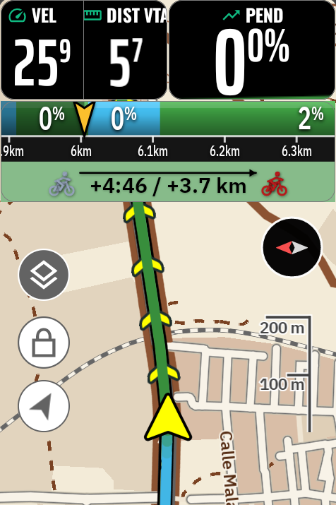

  

# ALTGRAPH (v1.0.85 ELITE)

Read in: <a href="https://github.com/DAVOE75/ALTGRAPH/blob/main/README.md">🇪🇸 Español</a> | <a href="https://github.com/DAVOE75/ALTGRAPH/blob/main/README_en.md">🇬🇧 English</a> | <a href="https://github.com/DAVOE75/ALTGRAPH/blob/main/README_fr.md">🇫🇷 Français</a> | <a href="https://github.com/DAVOE75/ALTGRAPH/blob/main/README_it.md">🇮🇹 Italiano</a> | <a href="https://github.com/DAVOE75/ALTGRAPH/blob/main/README_de.md">🇩🇪 Deutsch</a> | <a href="https://github.com/DAVOE75/ALTGRAPH/blob/main/README_pt.md">🇵🇹 Português</a>

  
  
  
  
  

**ALTGRAPH** is a next-generation professional altimetry and cycling performance extension for **Hammerhead Karoo** computers (Karoo 2 and Karoo 3) developed by **hesiOX** using the official `karoo-ext` SDK.
It revolutionizes traditional cycling elevation profiles by featuring a **Suite of 6 Altimetry 3D Visualization Models** with a live dynamic selector, continuous monochromatic 15-segment gradient scale, a 50-meter quantum rolling window advance, adaptive multiscale resolution, mountain pass analysis, optional topographic calculation (pure horizontal projection), mathematical hairpin turn (tornanti) detection, POI categorization (Towns, Fountains, Viewpoints, Summits), tap-to-zoom controls, Google Sans / Condensed fonts, 90° rotated full-screen landscape mode, dual **VAM** target pace with recommended speed, and scientific calculation of the **Fatigue Grade (GF)**.

  

## 👻 NEW INTEGRATION: KGHOST WIDGET IN ALTIMETRY RADAR (v1.0.85 ELITE) 👻

In Radar Elite Features, you can now enable the **KGhost Gap**, giving you a live head-to-head tactical widget against your virtual Ghost rider directly on the Altimetry Radar alert bar:
- **Professional Dual Cyclist Rendering**: Real rider in burgundy red and Ghost rider in metallic light grey with subtle drop shadows, linked by a dynamic arrow pointing directly at the current leader.
- **Real-Time Tactical Positioning**: If you lead, your cyclist appears ahead (on the right in horizontal mode, or on top in vertical mode). If the Ghost leads, it visually takes the front.
- **Live Performance Metrics**: High-precision real-time gap in time and distance (e.g., `+4:46 / +3.7 km`).
- **Smart Alternation**: Smoothly cycles every 4 seconds between the Ghost widget and tactical climb/wall alerts to ensure you never miss upcoming gradient challenges.
- **Special Thanks & Collaboration**: This feature is made possible thanks to the extension and close collaboration with the **KGhost** application developed for Hammerhead Karoo. Using this feature requires having the **KGhost** app installed, and we extend our sincere gratitude to their development team for their collaboration in advancing cycling performance tracking.

  

## 🔥 VERSION 1.0.80: BASE MAP ROUTE COLOR SMOOTHING & OPTIMIZED ICONS 🔥

- **Smooth Grade Transitions on Base Map**: Just like in classic radar view, added the option to blend and smooth color transitions along the colored route polyline on the base map.
- **Official Standardized Icons**: Perfect square aspect ratio mipmap generation for ultra-crisp display in Karoo's About section and Extension Store.
- **Full Multi-Language Support**: Complete translations across Spanish, English, French, Italian, German, and Portuguese.

## 🔥 VERSION 1.0.78: TV PROFILE 2D (ELITE) 🔥

- **TV Profile 2D (ELITE Novelty)**: A new visual data field replicating grand cycling television broadcast profiles (Giro / Tour / Vuelta). It renders the stage silhouette and dynamically fills the ridden area in real time with your chosen neon tone (**Tour de France Yellow**, **Giro d'Italia Pink**, **La Vuelta Red**, Classics Green, Cyan, or Clean White).
- **Climb Detection & Centered Climb List**: High-contrast light grey pass shading and route minimap tracking, accompanied by a centered climb breakdown (categories, distances, and average grades).
- **90° Landscape Rotation**: Includes an exclusive Elite menu toggle to rotate the chart 90º for maximum visual width on Karoo.

  

  
  
  

## 🚀 VERSION 1.0.44: DYNAMIC PACING & SMOOTH GRADIENTS 🚀

- **Power Guide / Pacing (ELITE Novelty)**: Intelligent pacing system integrated into the Altimetry Radar. Based on your FTP, Altgraph calculates ideal watts for each section of the climb in real time, displaying live tactical strategy cues on screen (e.g., `⚡ TARGET: 240W` or `🔴 PUSH: 300W`). Your personal sports director on your handlebars!
- **Smooth Gradients (ELITE Novelty)**: Option to smooth visual transitions between gradient blocks in the Altimetry Radar. Colors merge seamlessly to produce an elegant continuous elevation flow.

## 🚀 VERSION 1.0.43: TERRAIN SURFACE TEXTURES (GRAVEL/MTB) 🚀

- **Surface Texturing (ELITE Novelty)**: New Elite Control Panel toggle to render terrain textures on the 3D ribbon. Dynamically overlays Gravel patterns (dark stippling) and Trail markers (crisscrossed trail lines) onto the elevation gradient.

*⚠️ Note: Currently runs in preview mode to showcase the graphics engine. Surface data will automatically bind to road telemetry once Hammerhead unlocks surface metadata in their developer SDK.*

## 🚀 STABILITY, RESOLUTION & TRACKING ENGINE (v1.0.10 - v1.0.40) 🚀

- **Custom Radar Resolution (ELITE Novelty)**: Lock Radar resolution to **20m, 50m, 100m, 150m, 300m, 500m, or 1km** instead of automatic scaling.
- **Armored GPS Tracking Engine**: Completely rewritten GPS interpolation across polyline routes. Eliminates resets to km 0 and distance calculation quirks during route recalculations or Climb Detect pass trim.
- **Black Gap Display Fix**: Clean block-width calculation ensuring the radar extends seamlessly to the screen edges.
- **Minimalist Icon**: Modernized official Karoo app icon.
- **Native Translations**: 100% full translations in English, Spanish, French, Italian, German, and Portuguese.
- **OTA Updates**: Streamlined in-app update checks reading `manifest.json`.

## 🚀 VERSION 1.0.9: ELITE GRADIENT ZONES HISTOGRAM 🚀

- **Gradient Zones (Histogram %)**: Visual data field displaying time and distance breakdown across 8 gradient tiers (Descent to Extreme >17%). Perfectly matched with Radar color coding.

## 🌟 VERSION 1.0.5: DYNAMIC SCALE & MAP ROUTE GRADIENT MATCH 🌟

- **Optional Dynamic Warnings**: Toggle 'Wall', 'Next Summit', and 'Meters to Top' banners on/off in Elite Settings to maximize graph canvas.
- **Gradient-Matched Route Line**: Real-time colored polyline on Karoo maps perfectly synchronized with the 3D Radar palette.

| 🗺️ Full Colored Route | 🗺️ Steep Section Detail | 🗺️ Individual Climb View |
| :---: | :---: | :---: |
|  |  |  |

## 🚀 VERSION 1.0.0: ALTIMETRY RADAR & PRO EXPERIENCE 🚀

### 🌟 Altimetry Radar (3D Map Overlay)
Superimposes prospective elevation terrain directly onto your navigation map on Karoo.

  

### 🔧 Key Improvements:
- **Training Zone Bar**: 7-zone power or heart rate color bar anchored to the bottom edge.
- **Precision Zoom Controls (+ / -)**: Fine-tune down to 50-meter blocks.
- **Horizontal Pan (< / >)**: Scroll ahead along the upcoming stage profile.
- **Native Landscape Mode**: Complete 90° orientation support for horizontal mounts.
- **Real-Time Rider Beacon**: Animated beacon tracking progress along the profile curve.

## 📸 Real Karoo 3 Screenshots

| 🎨 Style Settings | 🎛️ Data Field Menu | 📊 Full Dashboard |
| :---: | :---: | :---: |
|  |  |  |

| 🏔️ 3D Altimetry (200m) | 🏔️ 3D Altimetry (1km) | 🏔️ 3D Altimetry (10km) |
| :---: | :---: | :---: |
|  |  |  |

| 🏔️ 3D Altimetry (20km) | 🏔️ 3D Altimetry (200km) | 🏔️ Climb Viewer (Cat 3) |
| :---: | :---: | :---: |
|  |  |  |

| 🏔️ Climb Viewer (HC) | 🏔️ Climb Viewer (Isometric) | 🗺️ Isometric GPS (Global) |
| :---: | :---: | :---: |
|  |  |  |

---

## 🌟 Suite of 6 Revolutionary Altimetry Models
Switch seamlessly between 6 visual perspectives in the **🎨 Style** settings tab:
1. **🏔️ Classic 3D (Default)**: Clean beveled 3D profile, gentle monochromatic 0–15% shading, rotated elevation marks, and high-contrast badges.
2. **🌅 Isometric Horizon (`Horizonte Iso`)**: Cockpit 3D horizon perspective with runway center dashes and dynamic headlight tilting to upcoming grade.
3. **❄️ Tactical Oasis & Cruicibles (`Oasis Tácticos`)**: Blue-highlighted recovery flats (`❄️ OASIS`) and crimson crucible alerts for brutal ramps (`🔥 WALL`).
4. **⚡ Force Field & Fatigue (`Campo Fuerza`)**: Gravitational tension lines, kinetic base sine wave, and floating VAM target guides.
5. **💎 Obsidian & Plasma Monolith (`Monolito`)**: Dark sculpted crystalline obsidian with radiant inner plasma core.
6. **🗺️ Global Isometric Map (`GPS Real`)**: Real isometric bird’s-eye wireframe built directly from GPS track coordinates.

### 🎨 High Visibility Intense Gradient Scale

| Gradient Range | Color | Hue | Riding Feel / Terrain |
| :--- | :---: | :--- | :--- |
| **≤ -10.0%** | 🔵 | Dark navy blue | Very steep descent |
| **-10.0% to -5.0%** | 🔵 | Dark blue | Medium descent |
| **-5.0% to -2.0%** | 🔵 | Medium blue | Mild descent |
| **-2.0% to < 0.0%** | 🔵 | Light sky blue | False flat downhill |
| **0.0% to 3.0%** | 🟢 | Intense forest green | Flat / Gentle incline |
| **3.0% to 5.0%** | 🟡 | Strong yellow | Moderate climb |
| **5.0% to 8.0%** | 🟠 | Intense orange | Demanding climb |
| **8.0% to 10.0%** | 🟠 | Dark terracotta orange | Steep ramp |
| **10.0% to 13.0%** | 🔴 | Intense red | Severe wall |
| **13.0% to 17.0%** | 🟤 | Dark garnet red | Extreme wall |
| **> 17.0%** | ⚫ | Jet black | Extreme grade (>17%) |

### 🔄 50m Quantum Rolling Window and Physical Advance
* The rider beacon physically ascends the upper contour of the slope from 0 to 50m.
* Upon completing each 50-meter increment, the window cleanly translates 50m to the left without abrupt scale jumps.

### ⚡ Zero-Allocation Architecture for Karoo 3
* Memory allocation-free rendering canvas: zero background Garbage Collector (GC) pauses.
* Real-time `Bitmap` and `Canvas` buffer reuse.

---

## 🆚 ALTGRAPH vs Native Karoo Climber
ALTGRAPH does not replace Karoo's native Climber, but elevates it by delivering an **all-in-one graphical perspective**:
- **Continuous Rolling Feed**: Elevation updates smoothly with every pedal stroke rather than jumping through static bar chunks.
- **Multiple Visual Models**: 6 futuristic rendering engines versus a single fixed view.
- **Tap Zoom Switching**: Seamlessly toggle between 200m, 1km, 10km, 20km, and 50km scales on the fly.
- **Fatigue Grade (GF)**: Scientific climb index derived from APM (Altimetrías de Puertos de Montaña) algorithms.
- **Independent Climb Viewer**: Full-screen stage analysis with Vuelta/Tour rating categories.

---

## 📲 Installation on Karoo 2 and Karoo 3
Built on the official `karoo-ext` SDK, installation requires **no root** and is 100% safe.

**Via Sideloading (Recommended for Karoo 3):**
1. Download `app-release.apk` from the latest [GitHub Releases](https://github.com/DAVOE75/ALTGRAPH/releases).
2. Transfer it to your Karoo using the official **Hammerhead Companion** smartphone app.
3. Once installed, ALTGRAPH checks for future updates automatically.

**Via ADB (Advanced):**
1. Enable Developer Options and USB Debugging on your Karoo device.
2. Connect to PC and execute: `adb install -r app-release.apk`

---

## ☕ Support the Project

If you enjoy ALTGRAPH and would like to support ongoing development:

  

